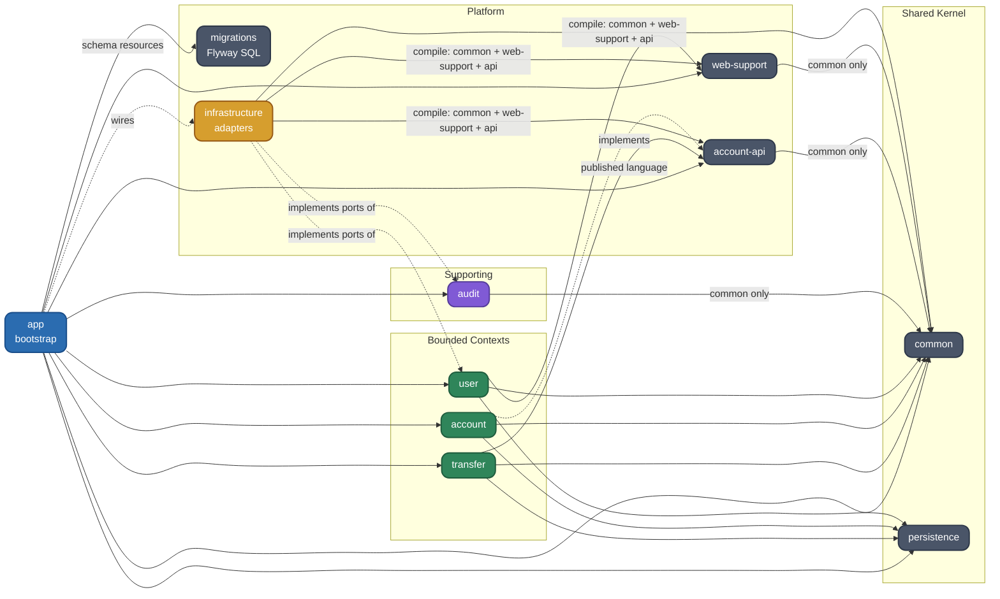

# Core Banking & Transfer System

A modular simulation of selected core banking workflows—account management and account-to-account transfers—built with **Spring Boot 3.5.16** and **Java 21**. It uses ports and adapters with architecture tests, PostgreSQL transactions, idempotency, and a browser UI. No real funds move, and this project is not a complete banking ledger or payment provider.

## Contents

- [Tech Stack & Prerequisites](#tech-stack--prerequisites)
- [Architecture & Module Dependency](#architecture--module-dependency)
- [REST API Endpoints (v1)](#rest-api-endpoints-v1)
- [Key Features & Design Decisions](#key-features--design-decisions)
- [Getting Started](#getting-started)
- [Testing & Quality Gates](#testing--quality-gates)

---

## Tech Stack & Prerequisites

### Core Framework & Language

- **Java 21:** Utilizes modern LTS features (e.g., Records, Pattern Matching).
- **Spring Boot 3.5.16:** Application backbone (Spring Web, AOP, Scheduling, Actuator).
- **Spring Security & JWT:** Bearer tokens for API clients; the same signed token is carried in an `HttpOnly` browser cookie with CSRF protection for the bundled UI. Logout revokes the token.

### Data & Caching

- **PostgreSQL 15:** Relational database with row locks, constraints, and Hibernate optimistic versions.
- **Flyway:** Database migrations run on startup; Hibernate's `ddl-auto=validate` checks the mapped schema and fails startup on detected mismatches.
- **Redis 7:** Shared account-snapshot cache in production, login attempts storage, and sliding window rate limiting (via Lua scripts).
- **Caffeine Cache:** Dev/test default (single-JVM, 60s TTL) when the `dev` profile runs on its own; the Compose dev stack overrides the snapshot cache, rate limiter and login-attempt store to Redis. Production uses Redis for snapshots, rate limiting and login attempts, and PostgreSQL+Redis hybrid token revocation during migration.
- **Micrometer + Prometheus:** Custom outbox, idempotency-backlog and orphan-integrity metrics exposed via Actuator. A scraper and alert destination must be installed separately.
- **springdoc-openapi:** Swagger UI for API exploration (disabled in production).

### Quality Assurance & Testing

- **JUnit 5 & Mockito:** Standard test suites and mocking.
- **Testcontainers:** Integration testing with a single shared PostgreSQL container (plus test-class-scoped Redis containers where needed).
- **ArchUnit:** Architecture verification to enforce Hexagonal boundary rules.
- **JaCoCo:** Quality gates enforcing $\ge 90\%$ Line and $\ge 80\%$ Branch coverage, enforced **per module** across all ten Java modules by `scripts/check_aggregate_coverage.py` (the resources-only `migrations` module has no bytecode) — the single source of truth, with thresholds mirrored from the root-pom `jacoco.line.coverage` / `jacoco.branch.coverage` properties. The `app`-module `jacoco:check` execution only validates that module's own classes, so the aggregate script is what actually gates a build.
- **Pitest:** A separate CI mutation-testing step is configured with a $\ge 80\%$ mutation threshold; it is not part of `test-all` or Maven `clean verify`.

### DevOps & Prerequisites

- **Docker & Docker Compose:** Multi-container orchestration.
- **Kubernetes:** Baseline manifests in `k8s/` (Deployment, HPA, PDB, probes). Secrets and production PostgreSQL/Redis deployments are not included (throwaway dev-only ones live in `k8s/postgres-redis-dev.yaml`).
- **Maven 3.9.x:** Recommended build system (Maven 3.9.16 wrapper configuration is pre-configured).
- **Prerequisites:** Java 21 JDK and a running Docker daemon. The local test launcher also needs Python 3.10+ and Node.js.
- **Environment:** Common local variables are shown in `.env.example`; profile-specific settings and deployment checks are in [operations](docs/operations.md).

---

## Architecture & Module Dependency

The project follows Hexagonal Architecture rules where the domain core remains isolated from framework dependencies, and adapters depend strictly on ports. Dependency flows **inward**: infrastructure adapters depend on domain modules, never the reverse.

### Module Breakdown:

Modules fall into three categories: **platform** (stable, shared, no BC dependencies),
**bounded contexts** (hexagonal slices, independently understandable), and **bootstrap** —
plus one supporting module (`audit`).

- **`app`** [Bootstrap]: Bootstraps the application (`BankApplication`) and wires all modules together. Houses most integration and WebMvc tests, plus the `OrphanIntegrityReporter` scheduled integrity observer.
- **`migrations`** [Platform]: Versioned Flyway SQL for the single PostgreSQL schema. Resources stay at the unchanged `classpath:db/migration` location, so Flyway history and checksums are untouched; the module owns schema packaging, not JPA entities. No Java. `app` depends on it at compile scope, and the `infrastructure` module adds it at test scope. Per-BC migration splitting remains a documented roadmap.
- **`common`** [Platform — shared kernel]: Framework-independent shared domain models, value objects, exceptions, and generic cross-cutting ports (`ClockProviderPort`, `IdGeneratorPort`, `IdempotencyPort`, `EventPublisherPort`, `AuditEventPort`, `OutboxEventPort`, `OutboxPort`, `SecurityContextPort`, `AuthenticatedPrincipalPort`, `TransactionBoundaryPort`). Framework-free shared web contracts (e.g., `ClientIpResolver`) also live here. Security-token ports (`JwtPort`, `TokenBlacklistPort`) live in `user`, not here.
- **`web-support`** [Platform]: Shared RFC 7807 rendering (`ProblemDetailFactory`, `BusinessErrorHttpMapper`) used by `infrastructure` filters/handlers and `user` web adapters; depends only on `common`.
- **`persistence`** [Platform]: Shared JPA base types (`AuditableJpaEntity` with Spring Data auditing). Kept as a separate module so `common` stays framework-free; `account`, `transfer` and `user` entities extend it without depending on `infrastructure`.
- **`account-api`** [Platform — published language]: Open Host Service of the Account context (`AccountApi`, `AccountSnapshot`, `AccountAdjustmentResult`) plus the shared snapshot-cache contract (`AccountSnapshotCache` + framework-free base). The only account-related contract downstream contexts may depend on; implemented by `account` via the inbound `AccountApiAdapter` (`account.adapter.in.api`).
- **`infrastructure`** [Platform]: Security filter chain, JWT/token-blacklist backends (implementing `user`-owned ports; production revocations are stored durably in PostgreSQL and checked alongside legacy Redis records), outbox poller/processor, Redis/Caffeine adapters (incl. the backend-selected `account-api` snapshot cache: Caffeine single-JVM for dev/test, Redis shared for production), and global exception handling (RFC 7807 rendering shared via `web-support`). Depends on BC port abstractions — never on BC adapter (concrete) classes, never on `account` internals.
- **`user`** [BC]: User registration, authentication, token lifecycle, TOTP-based MFA (opt-in enrollment/confirmation/removal + code-enforced login) and enumeration-safe password reset. Owns `JwtPort`, `TokenBlacklistPort` and `LoginAttemptPort` — their implementations live in `infrastructure` (token/backends) or colocated adapters. Login uses short read-only transactions for credential/user lookup; login-attempt state is handled outside those DB transactions (Redis in production, Caffeine locally).
- **`account`** [BC]: Bank account lifecycle, balance mutations, and details. Implements `account-api`. Publishes its own domain events; callers only see the opaque `AccountAdjustmentResult`.
- New account creation derives the owning user from the authenticated principal and generates a checksum-valid, simulation-only Turkish IBAN. Earlier format-only records remain readable; see [IBAN rollout](docs/iban-checksum-rollout.md) before using an existing database.
- **`transfer`** [BC]: Simulated transfers, conditional cancellations (a configurable window and sufficient recipient balance), and paginated reporting. Talks to `account` only via the `account-api` published language; transfer and cancellation endpoints require `Idempotency-Key`.
- **`audit`** [Supporting]: Mandatory audit persistence for money movements participates in the use-case transaction; a failed write rolls the movement back.

**Module dependencies** (arrow = compile-time dependency direction; dashed arrow = port implementation or composition-root wiring):



Test-scope edges (for example `infrastructure` → `account`/`migrations`) are intentionally omitted; the graph shows compile-time dependencies.

| Rule                                        | Meaning                                                                                                                                                      |
| :------------------------------------------ | :----------------------------------------------------------------------------------------------------------------------------------------------------------- |
| `transfer` → `account` **forbidden**        | Transfer must never touch the account module at compile time — `account-api` only                                                                            |
| `infrastructure` → BC adapter **forbidden** | Infra implements ports owned by the contexts, never uses concrete adapter classes                                                                            |
| `infrastructure` → `user`/`audit` compile edge | Deliberate and port-only (no BC adapter/internals); `user-api`/`audit-api` published languages would remove even this edge — tracked follow-up, not a violation |
| `web-support` → `common` **only**           | Shared Spring-dependent RFC 7807 rendering must not depend on a BC or `infrastructure`; framework-free web contracts stay in `common`.                        |
| Scalar IDs with DB FKs                    | Java modules use scalar references; V24 restores PostgreSQL foreign keys for user/account/transfer integrity. `OrphanIntegrityReporter` remains an observer. |
| Flyway resource ownership                 | Only `migrations` packages `db/migration`; BCs own their JPA entities, not the schema files. |

> The full dependency matrix is enforced at build time by the architecture test suite (`app/.../architecture/`: domain-purity, layering, module-boundary, naming, authorization-invocation, cache-invalidation and coding-invariant rules, plus a no-cycle rule over module slices); the six rules above cover what you need to know.

> [!NOTE]
> `transfer` never depends on the `account` module — only on its published language (`AccountApi`). Balance mutations return transfer-owned results, account events never cross the boundary, and account mutations invalidate affected cached snapshots.

---

## REST API Endpoints (v1)

All request paths are prefixed with `/api/v1`. Protected endpoints accept `Authorization: Bearer <token>` for API clients or the bundled UI's same-origin browser cookie. Unsafe cookie-authenticated requests also require `X-CSRF-Token`; see the [browser session contract](docs/browser-session.md). Registration, both login endpoints, both refresh endpoints and both password-reset endpoints are public (refresh endpoints authenticate with the refresh token itself, not the session; reset endpoints are rate-limited and enumeration-safe). Logout is public too: it authenticates with the credentials it presents (the access token and/or the refresh token) and revokes exactly those — requiring a still-valid session would make logging out impossible once the access token had expired. Paths under `/admin/**` require `ROLE_ADMIN`, and admin requests (including `/actuator/loggers/**`) also require the admin account to have confirmed TOTP enrollment; otherwise they return `403` with `Admin MFA enrollment required`. The auth, account, transfer, admin and **MFA** paths have rate limits; the MFA code check additionally has an account-keyed attempt budget. Mutating requests larger than 2 MB (`app.security.request-body.max-bytes`) are rejected with `413` before authentication. MFA (TOTP) is per-user opt-in for ordinary users and mandatory for admin-path access; see [MFA decision](docs/decisions/mfa-totp.md). Production requires `MFA_ENCRYPTION_KEY` (Base64, 32 bytes) for TOTP-secret encryption at rest.

| Module | Endpoint | Method | Description / notes |
| :--- | :--- | :--- | :--- |
| User | `/auth/register` | `POST` | Register; `Idempotency-Key` recommended. |
| User | `/auth/login` | `POST` | Obtain a bearer JWT for API clients. MFA-enrolled users must also send `totpCode`. |
| User | `/auth/refresh` | `POST` | Rotate tokens with a valid refresh token. |
| User | `/auth/logout` | `POST` | Revoke the presented access token and/or refresh-token session. |
| User | `/auth/mfa/enable` | `POST` | Start TOTP enrollment (auth); returns authenticator material. MFA stays off until confirmed. |
| User | `/auth/mfa/status` | `GET` | Read MFA enrollment status for the authenticated user (drives the UI). |
| User | `/auth/mfa/confirm` | `POST` | Confirm enrollment with a TOTP code; enables MFA for subsequent logins. |
| User | `/auth/mfa/disable` | `POST` | Remove MFA after password re-authentication + current TOTP code. |
| User | `/auth/password/reset/request` | `POST` | Public. Always 202 (no enumeration); sends a single-use token out-of-band. |
| User | `/auth/password/reset/confirm` | `POST` | Public. Consume the token, set the new password, retire sessions. |
| User | `/auth/browser/login` | `POST` | Set `HttpOnly` session and readable CSRF cookies; no token in JSON. |
| User | `/auth/browser/refresh` | `POST` | Same rotation over cookies for the bundled UI. |
| User | `/auth/browser/session` | `GET` | Restore the browser session. |
| User | `/auth/browser/logout` | `POST` | Revoke the cookie session; requires CSRF header. |
| Admin | `/admin/accounts/{id}/suspend` | `POST` | Suspend an account (`ROLE_ADMIN`; re-suspend is idempotent). |
| Admin | `/admin/audit-logs` | `GET` | Read the audit trail (`ROLE_ADMIN`). |
| Account | `/accounts/capabilities` | `GET` | Report whether simulated opening funds are enabled. |
| Account | `/accounts` | `POST` | Open an account for the authenticated user; the server generates a simulation-only Turkish IBAN. `Idempotency-Key` recommended. |
| Account | `/accounts` | `GET` | List the authenticated user's accounts (paged). |
| Account | `/accounts/{id}`, `/accounts/iban/{iban}` | `GET` | Return only an account owned by the caller. |
| Transfer | `/transfers` | `POST` | Execute a simulated transfer; `Idempotency-Key` required. |
| Transfer | `/transfers/{id}` | `GET` | Query transfer details. |
| Transfer | `/transfers/{id}/cancel` | `POST` | Conditionally reverse a completed transfer; `Idempotency-Key` required. |
| Transfer | `/transfers/history/{accountId}` | `GET` | Paged transfer history. |
| Transfer | `/transfers/report` | `GET` | Paged date-range report with `pageTransferCount`, `pageVolume` and `hasNext`; supports `cursorCreatedAt`+`cursorId` keyset paging and `includeTotals=true` for whole-range totals. |
| Transfer | `/transfers/report/combined` | `GET` | **Deprecated, sunset 2027-06-30** (still served with `Deprecation: true` + `Sunset` headers and a `Link: rel="successor-version"` to `/transfers/report?includeTotals=true`): same page plus whole-range `totalCount`/`totalVolume` in one call. New clients use `/transfers/report?includeTotals=true`. |
| Transfer | `/transfers/report/totals` | `GET` | Whole-range `totalTransferCount`/`totalVolume` totals for the criteria. |

**Pagination and caching:** history and report reads reject offset windows above 10,000 rows with `400`; reports also reject a date range longer than 12 months. Use the `/transfers/report` keyset cursor (`cursorCreatedAt` + `cursorId`) beyond the offset window. Account/transfer detail reads and paged report reads support `If-None-Match` and return `304` when the representation is unchanged.

> [!IMPORTANT]
> **Admin access is not self-service.** The `dev`/`demo` seed creates only `ROLE_USER` accounts (`ahmet` and `ayse`; see `application-dev.yml`), and no role-management endpoint is exposed. For local testing, promote a user in the database and bump both version counters so existing sessions are retired:
>
> ```sql
> UPDATE users
> SET role = 'ROLE_ADMIN', token_version = token_version + 1, version = version + 1
> WHERE username = 'ahmet';
> ```
>
> Sign in again, then enroll TOTP through the UI's security section or `POST /auth/mfa/enable` (body: `{"password":"..."}`) followed by `POST /auth/mfa/confirm` (body: `{"password":"...","code":"123456"}`). Admin endpoints keep returning `403 Admin MFA enrollment required` until enrollment is confirmed. This SQL is for a local database only; production needs an audited provisioning process.

---

## Key Features & Design Decisions

- **Hexagonal Architecture (Ports & Adapters):** Bounded contexts (`account`, `transfer`, `user`) and the supporting `audit` module never depend on `infrastructure`; infrastructure implements context-owned ports, and each port lives in its owning module.
- **AOP Programmatic Transactions (`UseCaseTransactionAspect`):** Isolates transaction management from business use cases. Mandatory audit records are saved through `AuditEventPublisherAdapter` in the caller's transaction, so an audit write failure rolls back the associated money movement.
- **Transactional Outbox:** Reliably publishes domain events via the `outbox_events` database table with per-partition polling, `SKIP LOCKED` row selection, and idempotent handlers (at-least-once delivery across restarts and retries; events that exhaust retries go to dead letter). The initial batch lock ends after selection; processing reacquires each event lock in a separate transaction. A failed event waits for an exponential backoff before the next attempt, so `max-retries` is a budget and not a count. Partition changes, dead letters, and retention are covered in [outbox operations](docs/outbox-operations.md).
- **Optimistic Concurrency Control (OCC):** Hibernate `@Version` rejects stale aggregate updates; transfer balance changes also use pessimistic account locks and domain balance checks.
- **Sorted Resource Locking:** Acquires pessimistic write locks (`SELECT ... FOR UPDATE`) in a consistent account-ID order (via `OrderedPair`) during debit/credit operations to reduce deadlock risk under concurrent transfers.
- **Bounded Context Decoupling (Anti-Corruption Layer - ACL):** The `transfer` and `account` modules communicate only through the `account-api` published language (Open Host Service), consumed via transfer's `AccountAclPort` contract and implemented via `AccountAclAdapter` (in `transfer.adapter.out.account`) delegating to `AccountApi`. This protects the transfer domain from database or structure changes inside the account module, and account domain events never leak across the boundary.
- **AOP Idempotency Guard:** Annotated account and transfer commands use `Idempotency-Key` records in the `idempotency_keys` table. Transfer and cancellation keys are required; account creation and registration keys are recommended. The record kind (HTTP request vs. outbox-handler dedup) is declared by the caller, so retention never sweeps a key under the wrong policy.
- **Resilience:** Revocation lookup fails closed with 503 when a required store is unavailable; production starts in hybrid DB+Redis mode to preserve Redis-only revocations during rollout, with a short-lived negative cache so the durable lookup does not compete with the money path for database connections. See [token revocation migration](docs/token-revocation-migration.md) and the [operations runbook](docs/operations.md). Rate-limited responses carry `Retry-After`.
- **Observability:** JSON logs in production (plain text locally) with request correlation IDs; outbox/backlog and orphan-integrity metrics, Redis health indicator and Prometheus-ready Actuator endpoint. Scraping, alert routing and restore drills remain deployment tasks.
- **Simulation funding:** Local dev/test profiles allow simulated opening balances. A hosted simulation uses `prod,simulation` to keep production security settings; `prod` alone allows zero opening balance. The UI reads `/accounts/capabilities` and mirrors that policy. See [simulation mode](docs/simulation-mode.md).
- **Notifications:** Current email and SMS adapters log simulated notifications; no external delivery provider is connected.

---

## Getting Started

Starts with a single command; no externally provided secret is needed. Both paths
supply a working JWT secret automatically (compose: zero-setup with the built-in
dev secret; `start-app-dev`: a fresh 256-bit secret per launch, never printed or
persisted). The resulting secret is for loopback-bound (`127.0.0.1`) local
development only; anything real requires
`export JWT_SECRET="$(openssl rand -base64 32)"`, and the prod profile refuses
to boot without it (fail-fast).

You can run PostgreSQL, Redis and the application together, or run Java on the host against Compose dependencies. The Compose defaults are for local development, not a public deployment.

Two paths lead to the same UI at `http://localhost:8080/` — pick by job, not by habit:

- **Path 1 — Run (all-in-Docker):** just run or demo the app, or validate the
  containerized image build. Needs only Docker; every code change costs an
  image rebuild.
- **Path 2 — Develop (host Java):** change code, attach a debugger, iterate
  fast. Needs Docker plus Java 21; only PostgreSQL/Redis run in containers
  while Maven and Java run on the host with the local `.m2` cache.

Run one path at a time: both bind `5432`, `6389` and `8080`, so they
conflict. To switch from Path 1 to Path 2, stop the app container first
(`docker compose stop app` — the launcher does this for you). To switch back,
stop the host app (Ctrl+C), then `docker compose up --build --wait` again.

### Path 1: Run Everything via Docker Compose

Single command — no env file or pre-generated secret needed. Recommended when you only want to run the app:

```bash
git clone https://github.com/BerkanApaydin/core-banking.git
cd core-banking
docker compose up --build --wait
```

Open the bundled UI at `http://localhost:8080/`. Compose creates the `bank_db` database, then the application's Flyway migrations create and update its tables automatically on startup. Hibernate validates the resulting schema. No manual SQL or `.env` file is needed for this local development setup: local dev boots with an insecure default signing key (a warning is logged; production refuses it — set a generated `JWT_SECRET` for anything real: `export JWT_SECRET="$(openssl rand -base64 32)"`). All published ports are loopback-bound (`127.0.0.1`), so the dev stack is unreachable from the network. The first run downloads images and Maven dependencies, so it needs internet access and can take 10–20 minutes; later runs reuse the build cache and start in about a minute. Ports `5432`, `6389` and `8080` must be free on the host; use `docker compose logs --tail=100 app` if startup fails. `docker compose down` stops the services while preserving PostgreSQL data in its named volume.

Compose and the development scripts explicitly select `dev`, which permits **simulated** opening balances. A standalone application now defaults to `prod`; select `dev` explicitly for local use. To host the simulation with production security settings, use `prod,simulation` and supply deployment-managed secrets and TLS; see [simulation mode](docs/simulation-mode.md) and [operations](docs/operations.md). A plain `prod` profile permits only zero opening balance.

Running a standalone application with the default `prod` profile fails fast at startup unless deployment-shaped configuration is supplied: a non-default `JWT_SECRET`, a `DB_PASSWORD` that is non-empty and not `bank_password`, `MFA_ENCRYPTION_KEY` (Base64, 32 bytes), and a `CORS_ALLOWED_ORIGINS` value without localhost origins. Prod defaults also require Redis for rate limiting, the failed-login store and the snapshot cache, with token revocation in hybrid DB+Redis mode; the startup validator checks these backend settings, while Redis connectivity is a runtime/health concern. Actuator moves to the private management port `8081`.

### Path 2: Develop with Java on Your Computer

Single command — the secret is generated automatically and process env is restored on exit (`SKIP_BUILD=1` reuses the existing JAR). Recommended when you change code: rebuilds reuse the host `.m2` cache and the app logs stream straight to your console, so iteration is minutes faster than an image rebuild and a debugger attaches without extra setup:

From the repository root, use the launcher for your operating system (Java 21, Docker and Docker Compose required):

```powershell
# Windows PowerShell or Command Prompt
.\start-app-dev.cmd
```

```bash
# Linux/macOS
bash start-app-dev.sh
```

The launcher stops the Compose app container if it is running, waits for PostgreSQL and Redis, builds the app with tests skipped, then serves the UI at `http://localhost:8080/`. It supplies the Compose database credentials and host Redis port (`6389`) and generates a fresh JWT secret automatically. No `.env` file or manual environment setup is needed. A fresh secret logs out existing browser sessions on each restart. Press Ctrl+C to stop Java; `docker compose down` stops the dependency containers. Run `test-all.cmd` (Windows) or `bash test-all.sh` (macOS/Linux) separately for the standard test suites and coverage checks.

The `dev`/`demo` seed creates `ahmet` and `ayse` as `ROLE_USER`; their passwords come from `DEMO_SEED_AHMET_PASSWORD` / `DEMO_SEED_AYSE_PASSWORD`. The `dev` profile falls back to the defaults in `application-dev.yml`; `demo` requires both variables.

- **Swagger UI (local profiles):** `http://localhost:8080/swagger-ui/index.html` (disabled in `prod`)
- **Actuator Health (local dev):** `http://localhost:8080/actuator/health`; in `prod` it is on the private management port at `http://localhost:8081/actuator/health` by default (`MANAGEMENT_SERVER_PORT`).

---

## Testing & Quality Gates

- **Run standard local checks:** `test-all.cmd` on Windows or `bash test-all.sh` on macOS/Linux. The launchers run the static CI/deployment/migration contracts, then Maven `clean install`, enforce aggregate JaCoCo coverage, generate the aggregate CycloneDX SBOM at `app/target/bom.json` and run the OSV dependency gate, followed by Python/JavaScript syntax checks and browser contract tests. Java 21, a running Docker daemon (for Testcontainers), Python 3.10+ and Node.js are required. The image-pin self-test uses PowerShell 7 or Windows PowerShell 5.1 when available; on macOS/Linux it is skipped if neither is installed. The command stops at the first failure and returns a nonzero exit code. If OSV is unreachable the dependency gate warns and skips; every other failure is fatal. PIT mutation testing, live health smoke, and data-writing load tests are separate checks.
- **Test Suite:** Unit tests reside in their respective modules; integration (Testcontainers) and WebMvc tests live mostly in `app`, with adapter-level integration tests also in `infrastructure`.
- **Verify Architecture Boundaries (ArchUnit):** Boundary rules from the table above, verified automatically on every build.
- **Integration Testing with Testcontainers & Flyway:** Integration tests run against a real PostgreSQL via Testcontainers with Flyway migrations and `ddl-auto=validate` for schema consistency.
- **Generate Coverage Report (JaCoCo):** `./mvnw clean verify` (or `.\mvnw.cmd clean verify` on Windows) runs unit and Testcontainers integration tests, then writes the ten-Java-module aggregate report to `app/target/site/jacoco-aggregate/index.html`. The VS Code task **JaCoCo: Run All Tests + Aggregate Coverage** uses this lifecycle and prints each module directly from the aggregate XML. VS Code's **Run Tests with Coverage** button uses the Java Test Runner's separate, project-by-project coverage view; its intermediate percentages are not the Maven aggregate quality gate.
- **Browser contract checks:** the `app/src/test/js/*.test.js` suite (`idempotency`, `frontend_contract`, `mfa-security`, `storage`) exercises session/idempotency, report pagination (offset page 0, keyset cursors past it, ETag cache rules), MFA login payload handling, safe storage fallbacks and funding-capability behavior. CI runs the whole suite; a real browser/TLS acceptance test is not yet included.
- **CI dependency checks:** CI is configured to reject newly introduced high/critical dependency advisories on pull requests and to publish an aggregate CycloneDX SBOM. These checks do not replace a review of vulnerabilities already present in the dependency baseline.
- **Dockerfile build & gated releases:** Every build compiles the `Dockerfile`; image scanning is delegated to the dependency gates above. Releases are manual-only and refuse to ship without a successful CI run on the exact SHA (`verify-green-ci`, plus a `production` environment for approval); the app and Flyway manifests ship digest-pinned (see [release automation](docs/release.md)).
- **Operational checks:** The read-only [health smoke](docs/operations.md) validates health and anonymous authorization responses. The [load-test guide](load_tests/README.md) separates rate-limit verification from data-writing capacity tests on an isolated simulation deployment.
- **Run Mutation Testing (Pitest) separately:** On a fresh checkout, first run `./mvnw clean install` (or `.\mvnw.cmd clean install` on Windows) so all reactor JARs, including the shared test JAR, are available to PIT's separate invocation. Then run `./mvnw pitest:mutationCoverage -Dpitest.skip=false` (or `.\mvnw.cmd pitest:mutationCoverage -Dpitest.skip=false` on Windows). CI follows the same sequence.
